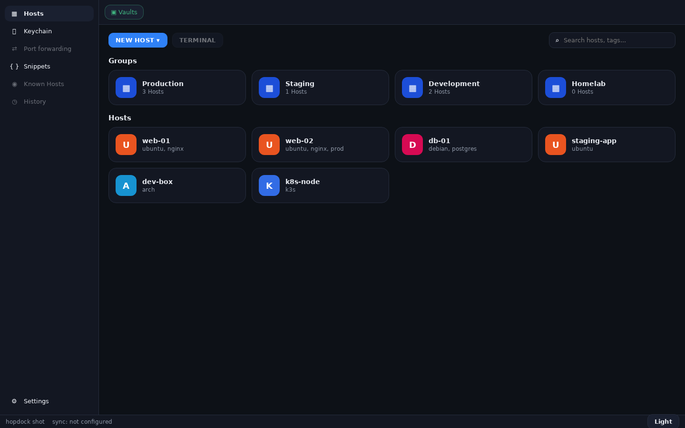
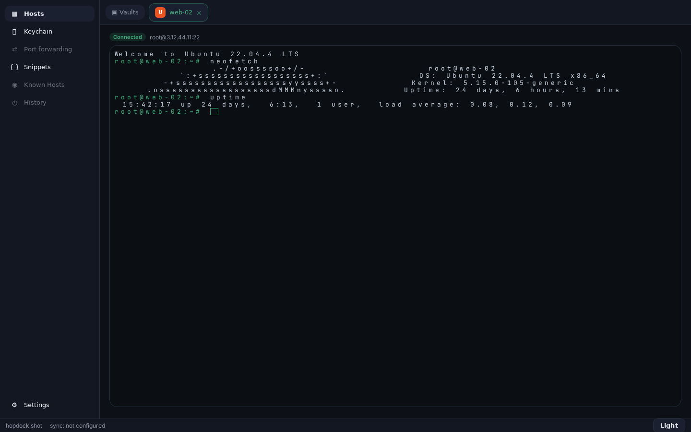
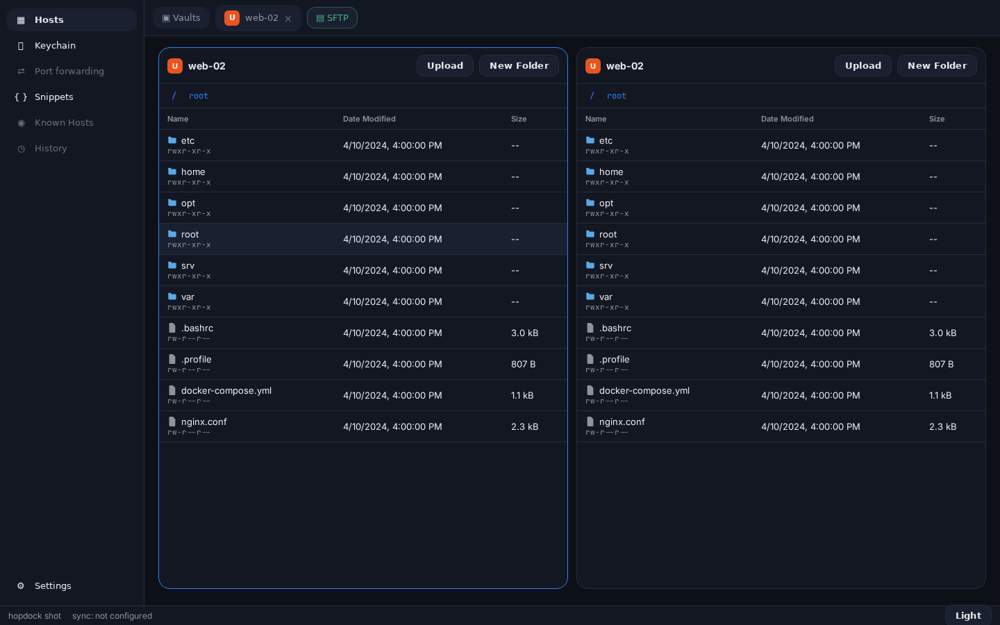

# Hopdock

Desktop SSH client, Termius-like MVP. Solo hobby project, Electron + React + TS.
Working title, verified clean in search. See `PLAN.md` for the full plan.

## Quickstart

```bash
npm install
npm run dev        # Electron with hot reload (M0: UI on mocks)
```

## Layout

```
apps/desktop       Electron shell (main/preload) + React renderer
packages/core      vault/host/key/snippet models + mock data (shared with future mobile)
packages/ui        design tokens (CSS vars) + AppShell/Sidebar/HostList/HostForm
supabase/          (M3+) schema + RLS for personal/shared vault sync
```

## Screenshots (v0.0.1, dark)

| Hosts | Terminal | SFTP |
|---|---|---|
|  |  |  |

## Milestones

- M0 — shell + hosts UI on mocks (this scaffold)
- M1 — ssh2 connect + xterm tabs
- M2 — SFTP drawer
- M3 — keys/snippets + Supabase sync (personal + shared vault)
